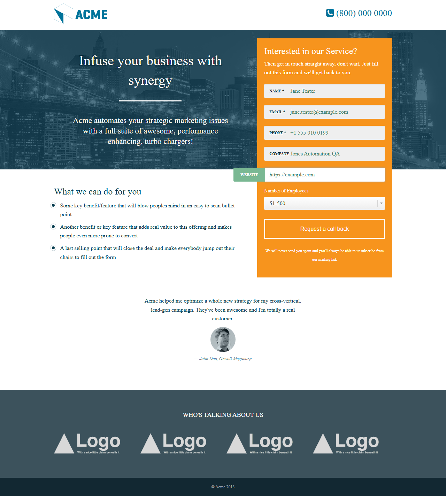

# Jones Automation — Playwright + Mocha

Automated tests for the Acme "Request a call back" form at https://test.netlify.app/,
built with [Playwright](https://playwright.dev/docs/library) and [Mocha](https://mochajs.org/).

## Requirements

- [Node.js](https://nodejs.org/en/download/) 20.19+, 22.13+ or 24+ (`node --version`)

## Install

```bash
npm install                       # Playwright, Mocha, cross-env
npx playwright install chromium   # the browser Playwright drives
```

## Run

```bash
npm test             # headless (default)
npm run test:headed  # visible browser, slowed down to watch
npm run lint         # check code style and common mistakes (ESLint)
```

Expected output:

```
  Request a call back
      Reached the thank-you page: https://test.netlify.app/thank-you.html?name=Jane+Tester&...
    ✔ submits a valid lead and reaches the thank-you page

  Request a call back: validation
    ✔ blocks submission when name is empty
    ✔ blocks submission when email is empty
    ✔ blocks submission when phone is empty
    ✔ blocks submission for invalid email "not-an-email"
    ✔ blocks submission for invalid email "jane.tester@"
    ✔ blocks submission for invalid email "@example.com"

  Known issues (pending until fixed)
    - #1 does not put personal data in the URL when the form is submitted
    - #2 accepts a website in the format its placeholder suggests
    - #3 rejects a phone value that is not a phone number

  Smoke
    ✔ loads the landing page with the call-back form

  8 passing (12s)
  3 pending
```

## What the tests cover

| File | What it checks |
| --- | --- |
| [`tests/callback-request.spec.js`](tests/callback-request.spec.js) | The assignment's flow: fill Name, Email, Phone, Company and Website → change Number of Employees from 1-10 to 51-500 → screenshot (`screenshots/before-submit.png`) → click "Request a call back" → reach the thank-you page and log it to the console. Every step is checked, including that the thank-you page received exactly the data that was typed. |
| [`tests/callback-validation.spec.js`](tests/callback-validation.spec.js) | Each required field left empty, and three invalid emails: the field shows a validation message, the form does not submit, and the typed values are kept. |
| [`tests/known-issues.spec.js`](tests/known-issues.spec.js) | The bugs below, written as tests of the correct behaviour and marked pending (`it.skip`) so the suite stays green. Removing `.skip` once a bug is fixed turns the test into a regression check. |
| [`tests/smoke.spec.js`](tests/smoke.spec.js) | The site is up and shows the form. If this fails, check the environment first. |

The bonus step (Number of Employees) runs before the screenshot, so the new value is visible in it.
Each run saves it to `screenshots/before-submit.png`; an example from a run is in
[`docs/before-submit.png`](docs/before-submit.png):



## Issues found on the site

| # | Issue | Severity | How to see it |
| --- | --- | --- | --- |
| 1 | **Personal data is sent in the URL.** The form submits with GET, so name, email and phone end up in the thank-you page's address, and from there in browser history, server and proxy logs, and analytics tools. The form should use POST. | High | Submit the form and look at the address bar. Test #1. |
| 2 | **Website rejects the format its own placeholder shows.** The placeholder is `example.com`, but the field (`type="url"`) only accepts full URLs, so typing `example.com` gives "Please enter a URL". | Medium | Type `example.com` in Website and submit. Test #2. |
| 3 | **Phone accepts any text**, e.g. `call me maybe`. For a "call back" form, an unusable phone number defeats the purpose. | Medium | Test #3. |
| 4 | **Email accepts `a@b`** (no domain such as `.com`). The browser's built-in email check is permissive; a stricter check is needed. | Low | Type `a@b` in Email and submit. |
| 5 | **The web font never loads.** The Google Fonts stylesheet is requested over `http://` from an `https://` page, so the browser blocks it (a "Mixed Content" console error) and the page falls back to a default font. | Low | Open the browser console on either page. |

## Configuration

All settings live in [`config/config.js`](config/config.js). Each one can be overridden with an
environment variable, so the same code runs locally, against another environment, or in CI.

| Variable | Default | Meaning |
| --- | --- | --- |
| `BASE_URL` | `https://test.netlify.app/` | Site under test |
| `HEADED` | off | `1` opens a visible browser |
| `SLOWMO` | `0` | Pause between browser actions (ms) |
| `ACTION_TIMEOUT` | `10000` | Max wait for a click / fill / select (ms) |
| `NAVIGATION_TIMEOUT` | `30000` | Max wait for a page load or URL change (ms) |
| `TEST_TIMEOUT` | `60000` | Max duration of one test (ms) |

Invalid values (for example `SLOWMO=fast`) stop the run immediately with a clear error message.

## How the tests run

- **One browser per run, a fresh page per test.** Chromium starts once (the slow part). Each test
  gets its own isolated browser context, so no cookies or form state carry over between tests.
- **Screenshot on failure.** When a test fails, a full-page screenshot is saved to
  `screenshots/failures/<test name>.png` and its path is printed under the failing test.
- **Fresh screenshots every run.** The `screenshots/` folder is emptied when a run starts, so every
  file in it comes from the latest run. Animations are finished before capturing, so the same page
  always produces the same screenshot.
- **Always cleaned up.** Pages and the browser are closed even when a test fails.
- **Clear errors.** A missing browser, an unknown form field, a dropdown option that doesn't exist,
  or a page that never loads each stop with a message that says what went wrong and where.

The shared parts live in [`support/`](support/) and are loaded for every test through
`.mocharc.js`, so test files contain only test steps.

## Project structure

```
config/config.js                    settings: site URL, browser mode, timeouts, paths
data/callbackForm.data.js           test data: a valid lead, invalid inputs, dropdown ranges
pages/BasePage.js                   shared by all page objects: open, wait until loaded, screenshot
pages/LandingPage.js                the landing page: form selectors and actions
pages/ThankYouPage.js               the thank-you page: load check, submitted values
support/browser.js                  start the browser, open and close isolated pages
support/screenshots.js              save and clear screenshots
support/hooks.js                    Mocha root hooks that wire it all together
tests/callback-request.spec.js      the assignment's flow, step by step
tests/callback-validation.spec.js   required fields and invalid emails
tests/known-issues.spec.js          bugs found, pending until fixed
tests/smoke.spec.js                 quick check that the site is up
docs/before-submit.png              example screenshot from a run
.mocharc.js                         Mocha settings (test files, hooks, timeout)
eslint.config.js                    lint rules
```

Each layer has one job:

| Layer | Knows about | Never contains |
| --- | --- | --- |
| `tests/` | what to check, in user language | selectors, URLs, hardcoded data |
| `pages/` | selectors and actions for one page | assertions |
| `data/` | input values and expected values | logic |
| `config/` | environment settings | test logic |
| `support/` | browser lifecycle, screenshots | anything page-specific |

So when the site's HTML changes, only `pages/` changes. When the data changes, only `data/` changes.

## Writing a test

Tests use page objects and test data, never raw selectors:

```js
const LandingPage = require('../pages/LandingPage');
const { validLead } = require('../data/callbackForm.data');

it('fills the call-back form', async function () {
  const landing = await new LandingPage(this.page).open();
  await landing.fillForm(validLead);
});
```

Use `function () {}`, not arrow functions, so Mocha can give the test its page as `this.page`.

## Adding a new page

1. Create `pages/MyPage.js` with a class that extends `BasePage`.
2. In its constructor, set `path`, define the page's selectors once, and set `loadedIndicator`
   (an element that is visible when the page is ready). Add `urlPattern` if the page is reached by
   navigation, so `waitUntilLoaded()` also checks the URL.
3. Add methods for what a user does on that page, named in user language (`submit()`, not
   `clickButton2()`).
